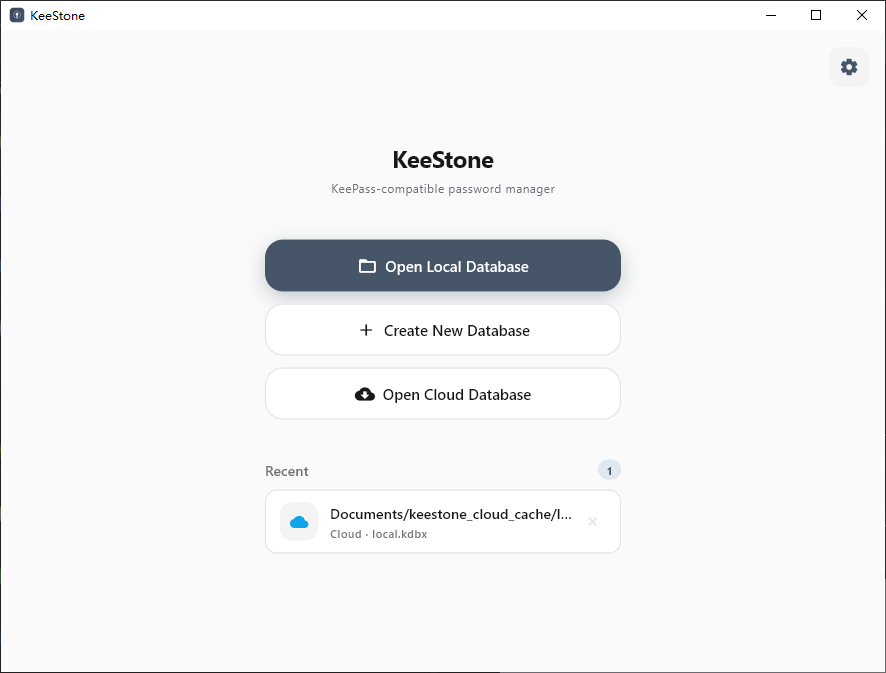

[中文](README_ZH.md) | **English**

# KeeStone

[](https://github.com/lyj404/keestone/releases)
[](LICENSE)
[]()

A cross-platform KeePass-compatible password manager built with Flutter.

<p align="center">
  
</p>

## Features

- Full KDBX 3.x / 4.x compatibility (read/write, merge sync)
- Cloud sync via WebDAV or Git (GitHub / Gitee / GitLab), TOTP, fingerprint
  unlock, key file dual-factor auth
- CSV / KDBX import & export (Chrome, 1Password, LastPass, Bitwarden, etc.)
- File attachments, entry history, custom fields, tags & groups
- Password generator, auto-lock/save, clipboard auto-clear, expiry reminders
- Local password health audit (weak / reused / expired passwords; no network)
- Optional Have I Been Pwned password breach checks
- Android autofill for browsers and apps; desktop AutoType
- Favorites and pinned entries, entry templates, username suggestions
- System tray, keyboard shortcuts, light/dark theme, Chinese/English

## Install

The features added during the 0.9.9 beta are available in the
[beta releases](https://github.com/lyj404/keestone/releases); they are not
included in the 0.9.6 downloads below.

Download version 0.9.6 for your platform:
| Platform | Download |
| --- | --- |
|  | ZIP: [](https://github.com/lyj404/keestone/releases/download/v0.9.6/KeeStone-v0.9.6-windows-x64.zip) [](https://github.com/lyj404/keestone/releases/download/v0.9.6/KeeStone-v0.9.6-windows-arm64.zip)<br>Installer: [](https://github.com/lyj404/keestone/releases/download/v0.9.6/KeeStone-v0.9.6-windows-x64-setup.exe) [](https://github.com/lyj404/keestone/releases/download/v0.9.6/KeeStone-v0.9.6-windows-arm64-setup.exe) |
|  | [](https://github.com/lyj404/keestone/releases/download/v0.9.6/keestone_0.9.6_amd64.deb) [](https://github.com/lyj404/keestone/releases/download/v0.9.6/keestone_0.9.6_arm64.deb) |
|  | `yay -S keestone-bin` or `paru -S keestone-bin` |
|  | [](https://github.com/lyj404/keestone/releases/download/v0.9.6/KeeStone-v0.9.6-macos-arm64.zip) [](https://github.com/lyj404/keestone/releases/download/v0.9.6/KeeStone-v0.9.6-macos-x64.zip) |
|  | [](https://github.com/lyj404/keestone/releases/download/v0.9.6/KeeStone-v0.9.6-android-arm64-v8a.apk) [](https://github.com/lyj404/keestone/releases/download/v0.9.6/KeeStone-v0.9.6-android-armeabi-v7a.apk) [](https://github.com/lyj404/keestone/releases/download/v0.9.6/KeeStone-v0.9.6-android-x86_64.apk) |

macOS builds are provided for Apple Silicon (arm64) and Intel (x64). The author
does not own an Apple device, so macOS builds have limited device testing and
may contain bugs. Bug reports and feedback are welcome via [GitHub Issues](https://github.com/lyj404/keestone/issues).

## Build from Source

Requires Flutter / Dart SDK >= 3.13.0

```bash
git clone https://github.com/lyj404/keestone
cd keestone
flutter pub get
flutter run -d windows    # or linux / macos / android
```

## Tech Stack

[Flutter](https://flutter.dev) · [Riverpod](https://pub.dev/packages/flutter_riverpod) · [go_router](https://pub.dev/packages/go_router) · [kpasslib](https://pub.dev/packages/kpasslib) · [WebDAV](https://pub.dev/packages/webdav_client) · [local_auth](https://pub.dev/packages/local_auth)

## Logs

When reporting a bug, attaching the log file helps a lot. KeeStone records
**warning and error** level messages, rotating at 2 MB per file with 5
generations kept (10 MB total) — the oldest files are removed automatically.

Log files are named `keestone-error.log` (plus older generations
`.1`–`.4`), located at:

| Platform | Location |
| -------- | -------- |
| Windows | `C:\Users\<user>\Documents\KeeStone\logs\`¹ |
| Linux | `~/Documents/KeeStone/logs/` |
| macOS | `~/Library/Containers/com.keestone.keestone/Data/Documents/KeeStone/logs/` (app sandbox) |
| Android | `/storage/emulated/0/Android/data/com.keestone.keestone/files/KeeStone/logs/` |

¹ Follows the system "Documents" known folder, which may differ if it has been
relocated.

On **macOS and Android**, where the path is hard to reach manually, use
**Settings → General → Export Logs** to save the log files to a chosen location.

## Password Health

Open **Password Health** from Tools, the overflow menu, or Settings (available on desktop and mobile). The standard scan is fully local.

| Check | Description |
| ----- | ----------- |
| Empty password | Entry has no password |
| Weak / fair password | Strength score is weak or fair |
| Reused password | The same password is used by two or more entries |
| Expired | Expiry date is in the past |
| Expiring soon | Expires within 7 days |

Results are ranked by severity. Tap a finding to open the entry and fix it. The report never includes plaintext passwords.

The optional **Check for breaches** action queries Have I Been Pwned's Pwned
Passwords service after confirmation. It uses k-anonymity: only the first five
characters of each password's SHA-1 hash are sent; the full hash and password
stay on the device. Network failures are reported separately from a clean result.

## Autofill and AutoType

On Android, enable **Autofill** in KeeStone's settings and select KeeStone as
the system autofill service. Unlock the database, then select a suggested entry
in a supported app or browser. Store a full URL such as
`https://example.com/login` in the entry's URL field; Android app package IDs
can be specified as `androidapp://com.example.app`. Filling requires device
authentication, independently of the app's biometric unlock setting.

To configure an Android app entry:

1. Find the app's package ID. For an app listed on Google Play, it is the
   value of `id` in its listing URL. Alternatively, connect the device with USB
   debugging enabled and run `adb shell pm list packages -3` to list installed
   third-party package IDs.
2. Edit the entry and put `androidapp://com.example.app` in its **URL** field,
   replacing `com.example.app` with the app's package ID. To use one entry for
   both a website and an app, separate values with a semicolon or a newline, for
   example: `https://example.com/login; androidapp://com.example.app`.
3. Save the entry, unlock the database, open the app's login screen and tap a
   username or password field. Select the KeeStone suggestion and authenticate
   when prompted. The target app must expose its login fields to Android autofill.

Desktop AutoType uses **Ctrl+Alt+A** to choose an entry and type into the
previously focused window. Entries can use a custom KeePass AutoType sequence.
On macOS, grant accessibility permission; on Linux, AutoType requires X11 and
is unavailable on Wayland.

An iOS Credential Provider extension is included in the source, but requires
Apple Developer signing and device setup and has not been presented as a tested
release feature. See [iOS setup and verification](ios/CredentialProvider/README.md).

## Organizing entries

Mark entries as favorites or pin them to the top; a favorites view is available
on desktop and mobile. New entries can use built-in templates for logins, bank
accounts, cards, secure notes, servers, identities and software licenses.
Username suggestions draw from the current database and can be disabled in settings.

## Cloud Sync

KeeStone supports two mutually exclusive sync backends; enabling one disables
the other.

- **WebDAV** — any standards-compliant server (Nextcloud, Jianguoyun, etc.).
- **Git** — stores the database in a private Gist (GitHub / Gitee) or
  Snippet (GitLab, including self-hosted). No repository needed: the first
  sync creates the gist/snippet automatically and later syncs update it.
  Requires a personal access token with gist/snippet write permission.
  Conflict detection works the same as WebDAV: when the remote copy changed
  since the last sync, a diff dialog lets you choose to download the cloud
  version or overwrite it.

## Friendly Links

- [LINUX DO Community](https://linux.do/)

## License

[Apache License 2.0](LICENSE)
