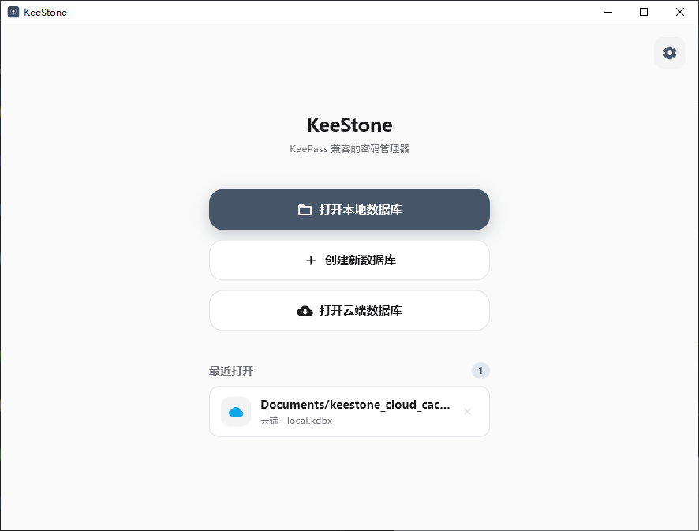

**中文** | [English](README.md)

# KeeStone

[](https://github.com/lyj404/keestone/releases)
[](LICENSE)
[]()

基于 Flutter 的跨平台 KeePass 兼容密码管理器。

<p align="center">
  
</p>

## 功能

- KDBX 3.x / 4.x 全兼容（读写、合并同步）
- WebDAV / Git 云同步（GitHub、Gitee、GitLab）、TOTP、指纹解锁、Key File 双因素认证
- CSV / KDBX 导入导出，兼容 Chrome、1Password、LastPass、Bitwarden 等
- 文件附件、条目历史、自定义字段、标签与分组
- 密码生成器、自动锁定/保存、剪贴板自动清除、过期提醒
- 本地密码健康审计（弱/重复/过期密码，不联网）
- 可选的 Have I Been Pwned 密码泄露检查
- Android 浏览器和应用自动填充、桌面端 AutoType 自动输入
- 收藏与置顶、条目模板、用户名自动提示
- 系统托盘、键盘快捷键、亮暗主题、中英文

## 安装

下载适用于对应平台的 1.0.0 版本：
| 平台 | 下载 |
| --- | --- |
|  | 压缩包: [](https://github.com/lyj404/keestone/releases/download/v1.0.0/KeeStone-v1.0.0-windows-x64.zip) [](https://github.com/lyj404/keestone/releases/download/v1.0.0/KeeStone-v1.0.0-windows-arm64.zip)<br>安装程序: [](https://github.com/lyj404/keestone/releases/download/v1.0.0/KeeStone-v1.0.0-windows-x64-setup.exe) [](https://github.com/lyj404/keestone/releases/download/v1.0.0/KeeStone-v1.0.0-windows-arm64-setup.exe) |
|  | [](https://github.com/lyj404/keestone/releases/download/v1.0.0/keestone_1.0.0_amd64.deb) [](https://github.com/lyj404/keestone/releases/download/v1.0.0/keestone_1.0.0_arm64.deb) |
|  | `yay -S keestone-bin` 或 `paru -S keestone-bin` |
|  | [](https://github.com/lyj404/keestone/releases/download/v1.0.0/KeeStone-v1.0.0-macos-arm64.zip) [](https://github.com/lyj404/keestone/releases/download/v1.0.0/KeeStone-v1.0.0-macos-x64.zip) |
|  | [](https://github.com/lyj404/keestone/releases/download/v1.0.0/KeeStone-v1.0.0-android-arm64-v8a.apk) [](https://github.com/lyj404/keestone/releases/download/v1.0.0/KeeStone-v1.0.0-android-armeabi-v7a.apk) [](https://github.com/lyj404/keestone/releases/download/v1.0.0/KeeStone-v1.0.0-android-x86_64.apk) |

macOS 提供 Apple Silicon（arm64）和 Intel（x64）版本。作者本人没有 Apple
设备，macOS 版本缺少真实设备测试，因此可能存在问题。欢迎通过
[GitHub Issues](https://github.com/lyj404/keestone/issues) 反馈 bug 和使用问题。

## 从源码构建

需要 Flutter / Dart SDK >= 3.13.0

```bash
git clone https://github.com/lyj404/keestone
cd keestone
flutter pub get
flutter run -d windows    # 或 linux / macos / android
```

## 技术栈

[Flutter](https://flutter.dev) · [Riverpod](https://pub.dev/packages/flutter_riverpod) · [go_router](https://pub.dev/packages/go_router) · [kpasslib](https://pub.dev/packages/kpasslib) · [WebDAV](https://pub.dev/packages/webdav_client) · [local_auth](https://pub.dev/packages/local_auth)

## 日志

反馈 Bug 时附上日志文件能帮助快速定位。KeeStone 记录 **warning 和 error**
级别的日志，单文件 2 MB 滚动轮转，最多保留 5 代（共 10 MB），超限自动删除
最旧的文件。

日志文件名为 `keestone-error.log`（以及更早的 `.1`–`.4` 代），位置：

| 平台 | 位置 |
| ---- | ---- |
| Windows | `C:\Users\<用户名>\Documents\KeeStone\logs\`¹ |
| Linux | `~/Documents/KeeStone/logs/` |
| macOS | `~/Library/Containers/com.keestone.keestone/Data/Documents/KeeStone/logs/`（应用沙盒内） |
| Android | `/storage/emulated/0/Android/data/com.keestone.keestone/files/KeeStone/logs/` |

¹ 跟随系统的「文档」文件夹，若该文件夹被重定向则路径不同。

**macOS 和 Android** 上路径不易手动访问，可使用
**设置 → 通用 → 导出日志**，将日志保存到指定位置。

## 密码健康

在**工具**、更多菜单或**设置**中打开「密码健康」（桌面端与移动端均可）。常规扫描完全在本地进行。

| 检查项 | 说明 |
| ------ | ---- |
| 空密码 | 条目未设置密码 |
| 弱 / 一般密码 | 强度评分为弱或一般 |
| 重复密码 | 同一密码被两条及以上条目共用 |
| 已过期 | 过期时间已过 |
| 即将过期 | 7 天内过期 |

结果按严重度排序，点击可直接打开条目修改。报告中不会出现明文密码。

可选的「检查泄露」操作在确认后联网查询 Have I Been Pwned 的 Pwned Passwords
服务。查询采用 k-匿名方式：仅发送密码 SHA-1 哈希的前 5 位，完整哈希和明文密码
保留在本机。网络失败会单独提示，不会视为未发现泄露。

## 自动填充与 AutoType

在 Android 上，先在 KeeStone 设置中启用「自动填充」，再将 KeeStone 选为系统
自动填充服务。解锁数据库后，在支持的应用或浏览器中选择提示的条目。条目的 URL
字段请填写完整地址，例如 `https://example.com/login`；Android 应用包名可写为
`androidapp://com.example.app`。填充时需要设备身份验证，与应用内的生物识别解锁
开关相互独立。

为 Android 应用配置条目的步骤：

1. 找到应用的包名。对于 Google Play 上架的应用，可查看商店页面链接中 `id` 参数的值；
   也可开启手机 USB 调试并连接电脑，运行 `adb shell pm list packages -3`，列出已安装的第三方应用包名。
2. 编辑条目，在 **URL** 字段填写 `androidapp://com.example.app`，将其中的
   `com.example.app` 替换为实际包名。同一条目同时用于网站和应用时，可用分号或换行分隔，
   例如 `https://example.com/login; androidapp://com.example.app`。
3. 保存条目并解锁数据库，打开目标应用的登录页面，点击用户名或密码输入框，选择 KeeStone
   的填充提示并按提示完成身份验证。目标应用需要向 Android 自动填充服务提供登录输入框。

桌面端可使用 **Ctrl+Alt+A** 选择条目并向先前聚焦的窗口自动输入，条目支持自定义
KeePass AutoType 序列。macOS 需要授予辅助功能权限；Linux 需要 X11，Wayland
会话暂不支持。

源码中还包含 iOS 凭据提供程序扩展，但需要 Apple Developer 签名和设备配置，
尚不能作为已验证的发布功能使用。详见 [iOS 配置与验证说明](ios/CredentialProvider/README.md)。

## 条目整理

可将条目收藏或置顶，桌面端和移动端均提供收藏视图。新建条目时可选择登录、银行账户、
银行卡、安全笔记、服务器、身份和软件许可证等内置模板。用户名自动提示来自当前数据库，
可在设置中关闭。

## 云同步

KeeStone 支持两种互斥的同步后端，启用其一将自动停用另一种。

- **WebDAV** — 任意标准服务器（Nextcloud、坚果云等）。
- **Git** — 数据库存储为私密代码片段：GitHub / Gitee 走 Gist，GitLab（含自建）走
  Snippet。无需创建仓库：首次同步自动创建片段，之后的同步都是更新它。需要具备
  Gist/代码片段读写权限的个人访问令牌。冲突检测与 WebDAV 一致：若云端在上次同步
  后有变动，会弹出差异对话框，可选择下载云端版本或用本地覆盖。

## 友链

- [LINUX DO 社区](https://linux.do/)

## 开源协议

[Apache License 2.0](LICENSE)
